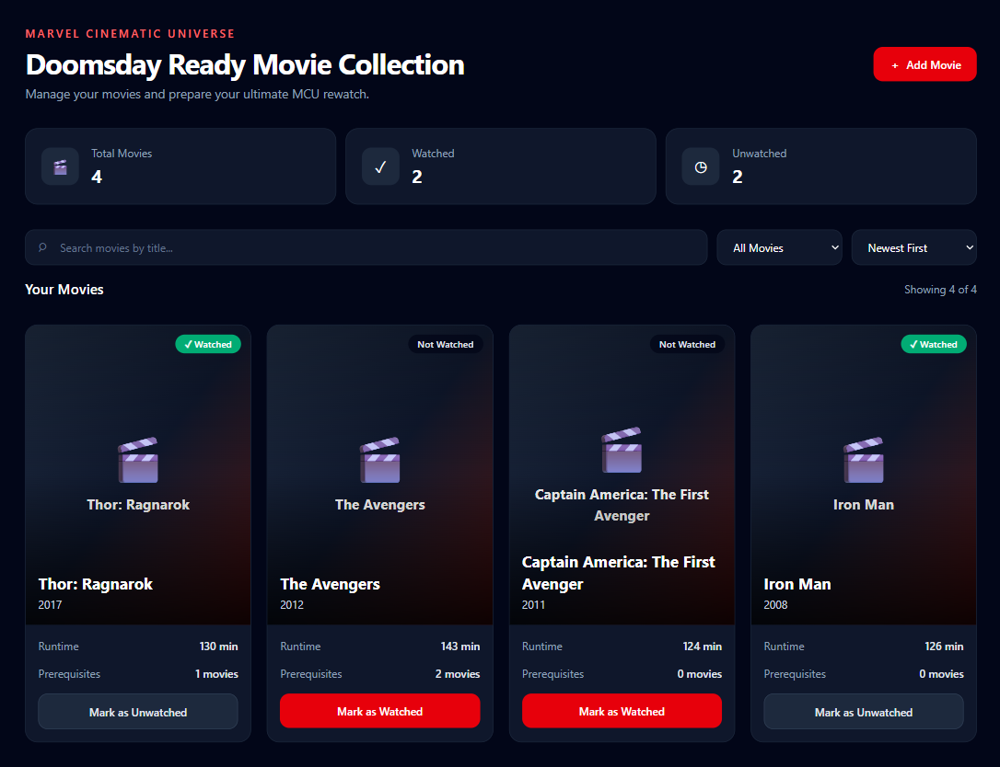
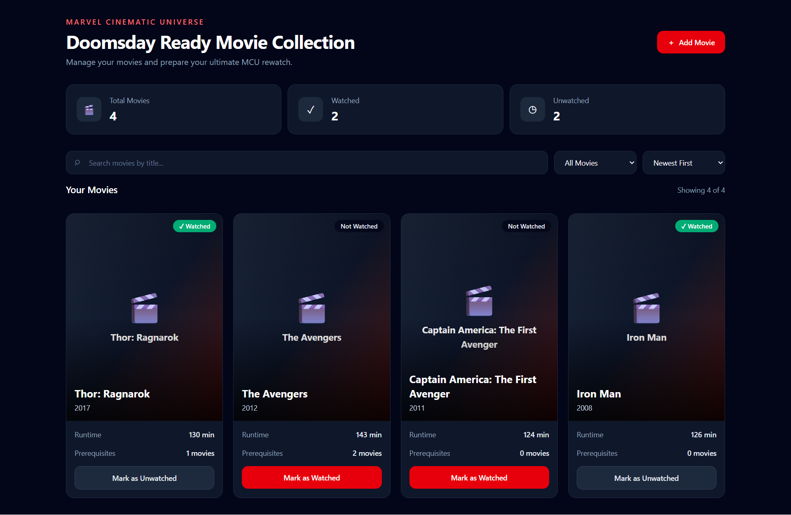
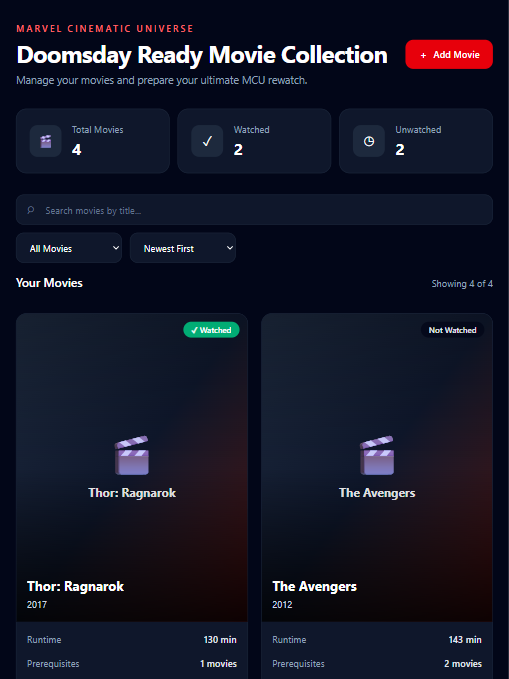
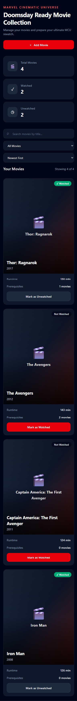

# 🎬 Doomsday Ready – Movie Collection

A responsive movie collection interface for managing and tracking your MCU movie rewatch journey. The Movie Collection page allows users to browse their movie library, search for movies, filter by watch status, sort movies, and track their watching progress.

Built with React, TypeScript, Redux Toolkit, and Ant Design, this frontend follows a modular and maintainable architecture.

---

## 📦 Tech Stack

- **React** – Component-based UI development
- **TypeScript** – Type-safe development
- **React Router** – Client-side navigation
- **Redux Toolkit** – Global state management
- **RTK Query** – API data fetching, caching, and synchronization
- **Ant Design** – UI component library
- **Tailwind CSS** – Responsive styling and layout
- **Vite** – Development server and build tooling

---

## 🎯 Features – Movie Collection

- **Movie Listing:** Fetch and display movies from the backend API.
- **Search Movies:** Search the collection by movie title.
- **Filter Movies:** Filter movies by watched and unwatched status.
- **Sort Movies:** Organize movies by release year or title.
- **Watch Status Tracking:** Mark movies as watched or unwatched.
- **Movie Statistics:** Display total movies, watched movies, and unwatched movies.
- **Prerequisite Information:** Display prerequisite movie counts for each movie.
- **Responsive Design:** Adapt the interface to mobile, tablet, and desktop screens.
- **Loading States:** Display loading skeletons while fetching movie data.
- **Error Handling:** Provide error feedback and retry functionality.
- **Empty States:** Display appropriate messages when no movies match the selected criteria.

---

## 🔌 API Integration

The frontend communicates with the Doomsday Ready backend using RTK Query.

| Method | Endpoint | Description |
|---|---|---|
| GET | `/api/v1/movies` | Retrieve all movies |
| GET | `/api/v1/movies/:id` | Retrieve a single movie |
| POST | `/api/v1/movies` | Create a movie |
| PATCH | `/api/v1/movies/:id` | Update movie information |

### API Features

- Centralized API configuration using `baseApi`.
- Automatic data fetching and caching through RTK Query.
- Cache invalidation using RTK Query tags.
- Type-safe API requests and responses.
- Automatic UI updates after successful mutations.

---

## 📁 Project Structure

```bash
src/
├── assets/                  # Static assets
├── components/
│   ├── form/                # Form components
│   ├── layout/              # Layout components
│   └── ui/                  # Reusable UI components
├── config/                  # Application configuration
├── hooks/                   # Custom React hooks
├── lib/                     # Helper libraries
├── pages/                   # Application pages
├── redux/
│   ├── api/
│   │   └── baseApi.ts       # Centralized RTK Query configuration
│   ├── features/
│   │   └── movie/
│   │       └── movieApi.ts  # Movie API endpoints
│   ├── hooks.ts             # Typed Redux hooks
│   └── store.ts             # Redux store configuration
├── routes/                  # Routing configuration
├── styles/                  # Global styles
├── types/                   # Shared TypeScript types
├── utils/                   # Utility functions
├── App.tsx
├── index.css
└── main.tsx
```

---

## ⚙️ Installation

### 1. Clone the repository

```bash
git clone <YOUR_FRONTEND_REPOSITORY_URL>
cd doomsday-ready-client
```

### 2. Install dependencies

```bash
npm install
```

### 3. Configure environment variables

Create a `.env.local` file in the project root:

```env
VITE_API_BASE_URL=http://localhost:5000/api/v1
VITE_APP_NAME=Doomsday Ready
```

Make sure the backend server is running before starting the frontend.

---

## ▶️ Running the Application

### Development mode

```bash
npm run dev
```

### Production build

```bash
npm run build
```

### Preview production build

```bash
npm run preview
```

### Run ESLint

```bash
npm run lint
```

---

## 🖼️ Screenshots

Add screenshots of the Movie Collection page here.

### Monitor View



### Desktop View



### Tablet View



### Mobile View



---

## 🤝 Contributing

Contributions are welcome!

1. Fork the repository.
2. Create a new feature branch.
3. Commit your changes.
4. Submit a pull request.

---

## 📄 License

This project is licensed under the MIT License.

---

## ✨ Author

**Nadim Mahmud Nion**

Full Stack (MERN) Developer

- GitHub: https://github.com/Nadim-Nion
- Portfolio: https://nion-portfolio.netlify.app/